# SEEIN 2.2.1

**Windows 仪表盘与耗能日历，其他功能由你选择安装。**

SEEIN 把硬件状态、能耗记录和常用桌面能力放在一个界面中。本体提供仪表盘、耗能日历、应用设置、插件与统一快捷键管理；副屏、应用监控、设备和小工具按需下载。没有安装的功能，不会加载对应实现或启动它的辅助进程。

[下载 2.2.1 本体 ZIP](https://github.com/SJTUHDT/SEEIN/releases/download/v2.2.1/SEEIN-2.2.1-win-x64-Core.zip) · [发布与校验文件](https://github.com/SJTUHDT/SEEIN/releases/tag/v2.2.1) · [安装说明](docs/INSTALL.md) · [更新记录](docs/CHANGELOG.md) · [第三方来源](THIRD-PARTY-NOTICES.md)

## 下载本体，再勾选功能

1. 下载本体 ZIP、核对校验值并解压，按照 [安装说明](docs/INSTALL.md)安装。
2. 打开 **应用设置 → 插件管理**，展开「副屏与主题」「应用监控」「设备控制」「小工具」。
3. 勾选大项可全选，勾选子项可单独安装；大项的横线表示只选了其中一部分。查看每项的用途、版本、大小及本次变更汇总。
4. 点击 **下载安装并重启**。SEEIN 从本仓库的官方 Release 下载，自动加入共享组件，验证签名与 SHA-256 后统一安装、重启一次。

下载不需要登录 GitHub。系统安装目录需要一次 Windows 管理员授权；有录制或导出进行中时先结束并保存。断网或取消下载不会修改现有安装，已验证的完整下载可在重试时复用。下载或安装失败会给出原因；安装事务可恢复原状态。

取消勾选已安装项表示准备卸载；右侧的「停用／启用」用于保留文件和设置、改变功能状态。变更均通过下方按钮一次提交。共享依赖自动处理，不需要用户手动安装。GitHub 访问不便时，仍可下载同版本 `.seeinplugin` 使用「导入本地插件包」；依赖包需一同准备，详情见安装说明。

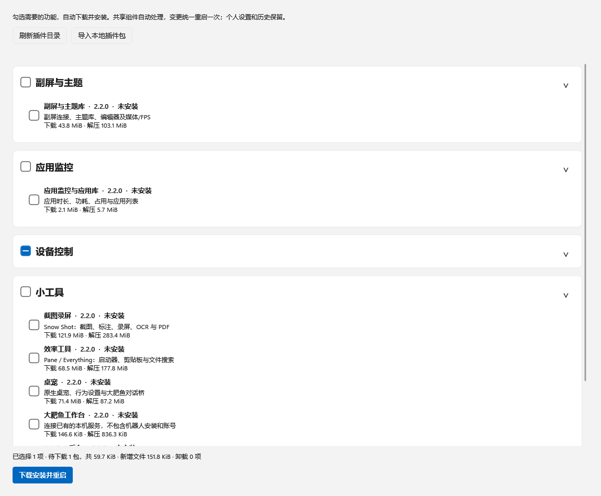

<details><summary>查看深色主题</summary>

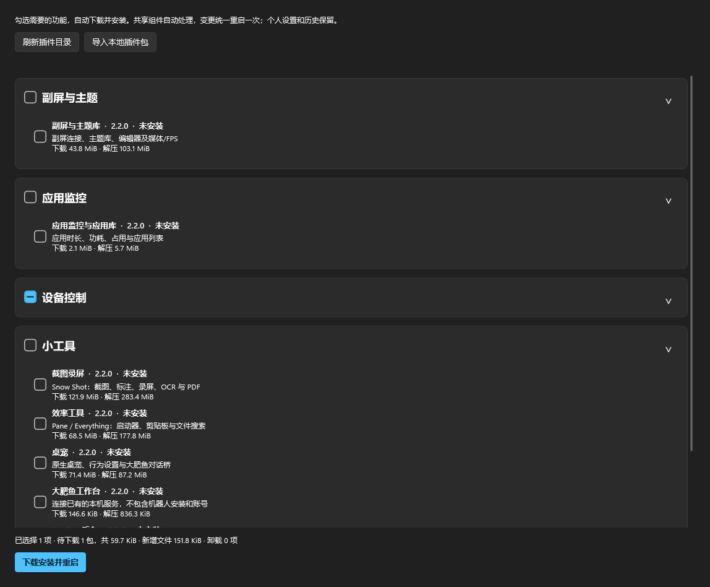

</details>

## 十四项可选功能

| 大项 | 可以选择的功能 | 完整说明 |
|---|---|---|
| 副屏与主题 | 一个完整插件：副屏连接、主题库、编辑器、媒体信息与 FPS | [副屏与主题](docs/plugins/display.md) |
| 应用监控 | 一个完整插件：应用时长、功耗、占用、应用列表 | [应用监控](docs/plugins/applications.md) |
| 设备控制 | **显示器设置、采集播放、灯效控制、风扇控制、中兴路由器、米家挂灯**，六项独立选装 | [设备控制](docs/plugins/devices.md) |
| 小工具 | **截图录屏、效率工具、桌宠、大肥鱼工作台、AstrBot 后台、QQ 后台**，六项独立选装 | [截图](docs/plugins/capture.md) · [效率](docs/plugins/efficiency.md) · [桌宠与肥鱼](docs/plugins/companion.md) |

只需要挂灯，就只选择「米家挂灯」，不会附带采集播放器、RGB 引擎和风扇后台。只选择 QQ 后台，不会下载桌宠动画和编解码器。多个功能需要同一套适配组件时仅安装一次。

截图录屏内部的通用、截图、录屏、识别与翻译、导出与存储仍是同一功能包的设置页；效率工具也保留为一个完整功能包。后台网页是已有本机服务的入口，不代表自动安装机器人、模型或 QQ 账号。

精确下载与解压体积见 Release 的 `COMPONENTS.json` 和应用内目录；本体自带 .NET 10，效率工具按需携带自己的 .NET 10。完整源码和第三方源码是开发/许可证附件，普通使用不需要下载或放进安装目录。

## 本体：仪表盘与耗能日历

### 仪表盘

查看 CPU/GPU 使用率、温度、功率、频率与电压，以及内存、磁盘、网络、风扇读数、会话能耗和累计能耗。可用读数取决于硬件与驱动，缺失的传感器不会生成虚构读数。使用日历帮助观察每天的使用情况；装好对应插件后可显示副屏、媒体、FPS 及挂灯状态。

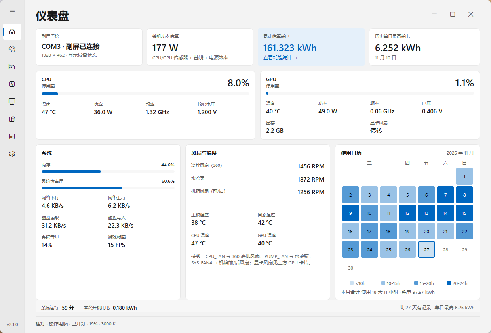

### 月度耗能与每日曲线

按月查看每日耗能、月总量和最高/最低日，点击日期查看 CPU、GPU、其他设备基线及电源损耗的估算分项。日视图可以切换功率曲线与采样条，按前后日查看。

连续缺少采样达到 **10 分钟**时功率曲线归零，较短缺口继续连接。分钟曲线保留最近 365 天，日总量长期保留；历史记录无法追溯的分项会列入未分类。

**整机功耗是 CPU/GPU 传感器加可调整基线、电源效率的估算，不是插座功率计的测量值。**

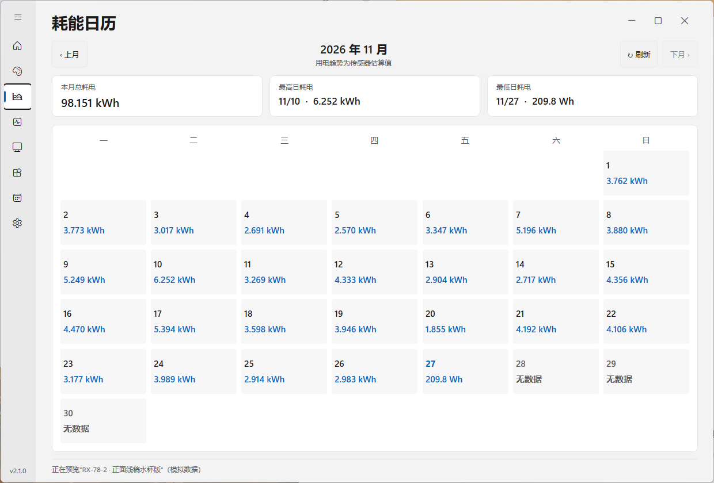

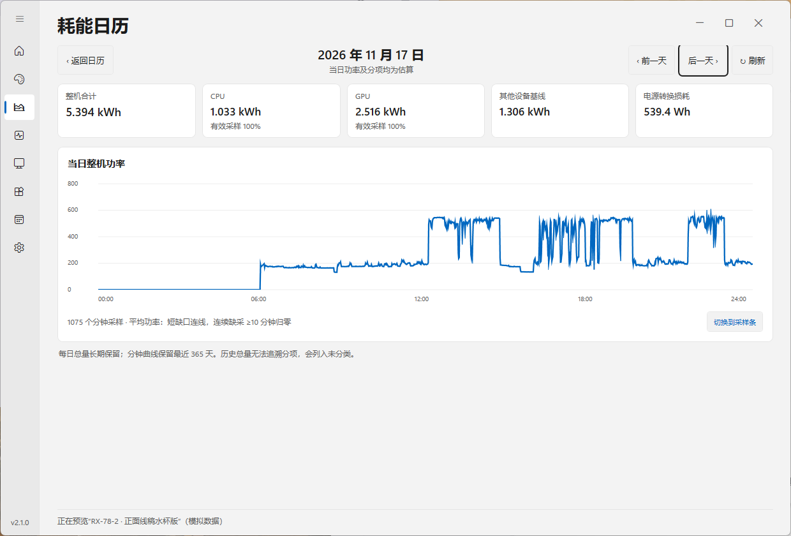

## 副屏与主题

导入 `.jptheme`、预览和应用主题，使用可视化编辑器编辑文字、图片、图形、卡片、时间、媒体信息及传感器数据绑定，支持图片/GIF/视频背景、图层、对齐和撤销。预览可以使用模拟数据，避免影响正在运行的副屏。

当前副屏协议针对 VID_33C3 / PID_F101、1920×462 设备，其他控制器与尺寸需要另行适配；不能根据主题截图认定所有副屏通用。

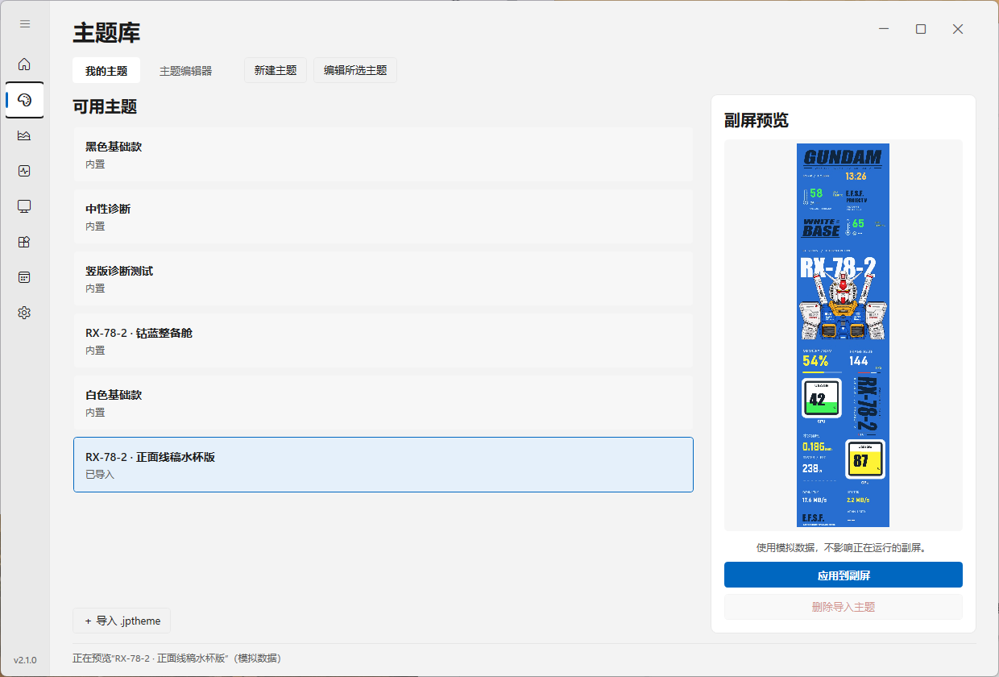

<details><summary>查看主题编辑器</summary>


</details>

## 应用监控

**应用时长**提供日/周统计、活跃时长、时间轴、应用排行和摘要；**应用功耗**展示分项构成、估算耗电和归属情况；**应用占用**提供 CPU/GPU 使用率与网络上传/下载。统计支持应用归并、隐藏和排序，多个进程可合并到同一应用。

应用列表显示在本体的「应用设置」中，由应用监控插件提供。未安装插件时，本体仍有插件与快捷键管理，不显示应用列表。

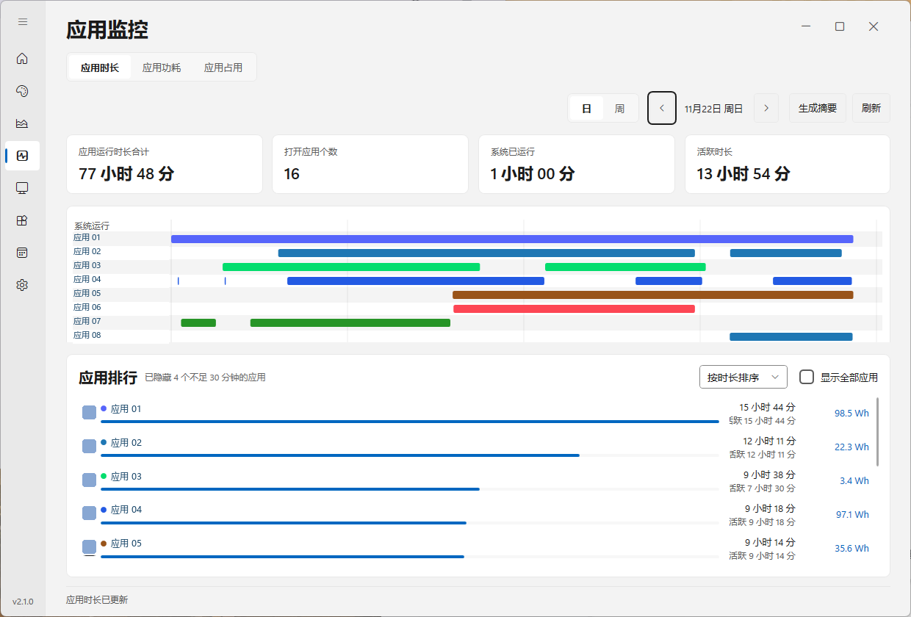

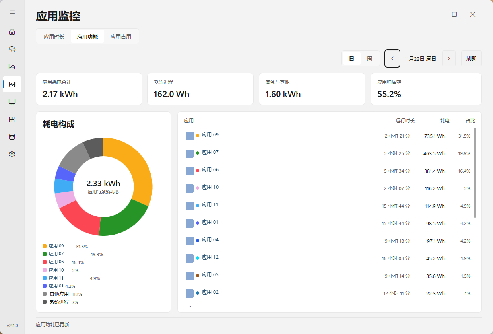

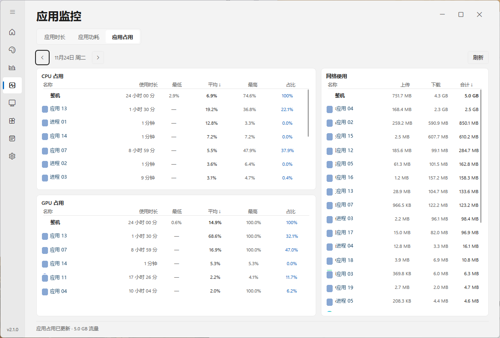

## 设备控制

- **显示器设置**：通过 DDC/CI 读取设备能力、切换输入源、管理输入名称和快捷键；需显示器与驱动支持。
- **采集播放**：选择 UVC 视频与 USB 音频设备、分辨率/帧率和输出端点，支持弹出与全屏。仅请求设备报告的模式；当前不提供录制、推流或游戏机电源控制。
- **灯效控制**：集成 OpenRGB，提供设备、场景、原生或软件效果与校色；是否可写取决于驱动、控制权及具体设备。
- **风扇控制**：冷排/机箱/显卡的受支持通道、温度曲线、控制权检查及交还。首次默认不接管未知设备。
- **中兴路由器**：嵌入用户填写地址的原厂页面，保留网页资料及本机加密的登录信息；已知适配型号为晴天 AX3000。
- **米家挂灯**：扫码授权、连接显示器挂灯2，调亮度/色温，保存与重命名预设。开关灯及预设快捷键统一在应用设置中管理。

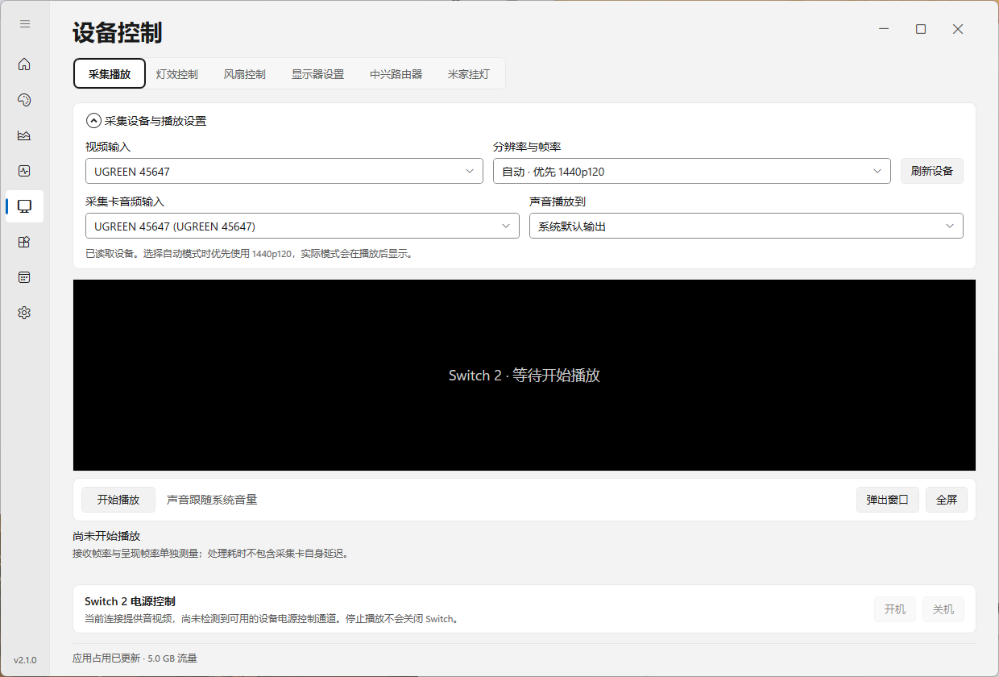

## 小工具

**截图录屏**基于 Snow Shot，保留区域/窗口/显示器/滚动截图、标注、历史、录屏、离线 OCR、翻译与图片转 PDF；统一管理外观、保存目录和呼出快捷键。翻译接口由使用者配置，离线 OCR 不要求模型密钥。

**效率工具**集成 Pane 与 Everything，提供启动器、剪贴板历史、文件搜索、文件夹跳转、批量重命名和定时关机。双击左 Alt 的剪贴板与双击右 Alt 的截图快捷键开关分别管理。

**桌宠**使用 dsh-pet 默认素材和移植行为，以 SEEIN 原生 WPF 子进程运行，不带 Electron。慢拖松手停留、快速抛出才飞行；单击不切换状态，默认累计五次播放回应动画。对话复用已有大肥鱼桥，模型和角色在肥鱼侧管理。

**大肥鱼工作台、AstrBot、QQ 后台**分别选装，连接已有本机服务。各自按原服务方式认证，配置位置在连接设置中；不是替使用者部署服务或赠送在线模型额度。退出托盘清理 SEEIN 自己持有的子进程，不接管原本独立运行的机器人服务。

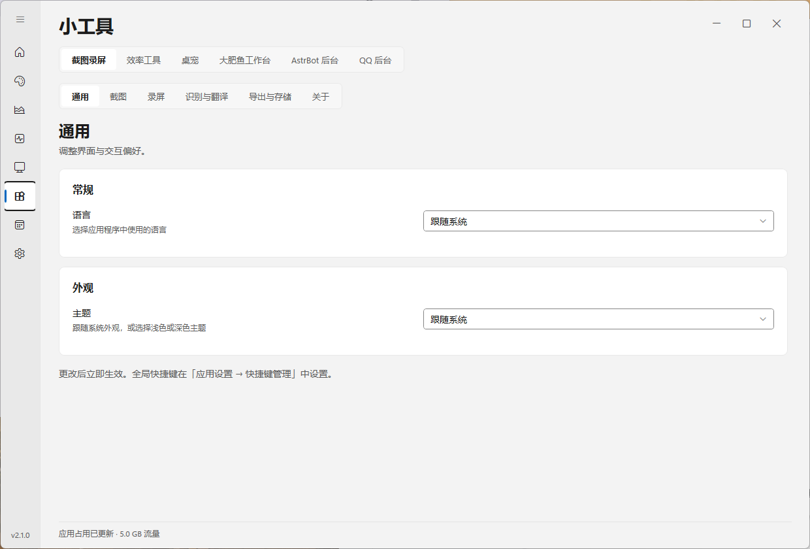

## 应用设置与日常操作

应用设置是本体栏目，集成插件管理、统一快捷键，以及应用监控插件提供的应用列表。全局呼出和设备快捷键集中配置，不必到多个功能页寻找入口。只有启用的功能会注册相应动作。

展开侧边栏和支持排序的子页签，长按约一秒进入悬浮拖动状态，移动换位后保存顺序。主窗口 × 收到托盘；「退出托盘程序」结束桌面端子进程，硬件后台按已启用策略独立工作。

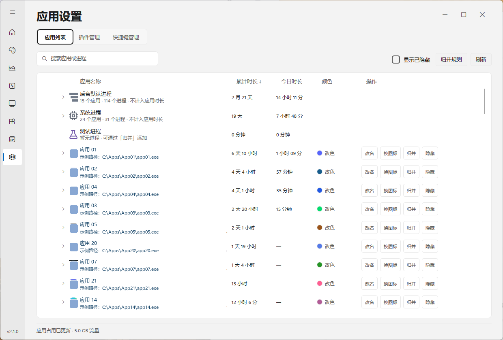

以上十张实机截图来自 2.1 系列界面，展示延续到 2.2 的功能；按提供者要求只匿名替换应用/进程名称、相关路径和识别图标，**原有能耗、时长和占用数值保留**。插件中心两张图由 2.2 实际控件离线渲染，使用同版签名目录，不能替代完整人工交互验收。

## 升级、隐私与兼容性

- 2.1.0 保留在历史 Releases。升级到 2.2 本体时保留同一发布者签名的现有插件；插件中心自动预选旧整包对应小项，统一迁移后保留启停状态、配置、快捷键和历史。
- 下载和安装失败不会清空历史。卸载插件保留个人数据；清除数据请先阅读 [存储与联网说明](docs/PRIVACY.md)。
- WebView2 Evergreen Runtime、硬件驱动、外部工作台和机器人由使用者准备。硬件支持范围见 [兼容性](docs/COMPATIBILITY.md)，本轮实测边界见 [验收记录](docs/ACCEPTANCE.md)。

## 开源来源、开发与反馈

Snow Shot、Pane、dsh-pet、OpenRGB 等保留原作者、原许可证及对应源码。每份插件文档区分上游能力与 SEEIN 的集成修改；没有把上游作品改称自研。

```powershell
pwsh -File scripts/build.ps1 -Configuration Release
pwsh -File scripts/publish.ps1 -Profile PublicFull # 构建全部功能包、签名目录和内部验收目录
pwsh -File scripts/publish.ps1 -Profile Core       # 官方发行仅推荐本体 ZIP
```

完整工具链与缓存准备见 [构建说明](docs/BUILDING.md)，功能包和事务见 [架构](docs/ARCHITECTURE.md)。反馈请注明版本、设备型号、复现步骤，勿上传授权、密码、剪贴板或个人数据库。

SEEIN 自有代码采用 [GPL-3.0-only](LICENSE)，第三方作品保持自身许可，见 [第三方声明](THIRD-PARTY-NOTICES.md)。

## English

SEEIN is a Chinese-language Windows x64 dashboard and energy calendar. Install Core, then select optional features in the built-in plugin center. Version 2.2 offers fourteen independent choices with signed GitHub downloads, shared dependencies and transactional installation. Modified Snow Shot and Pane components and dsh-pet/OpenRGB integrations retain upstream attribution, licenses and corresponding source. Hardware support and acceptance limits are documented separately.
