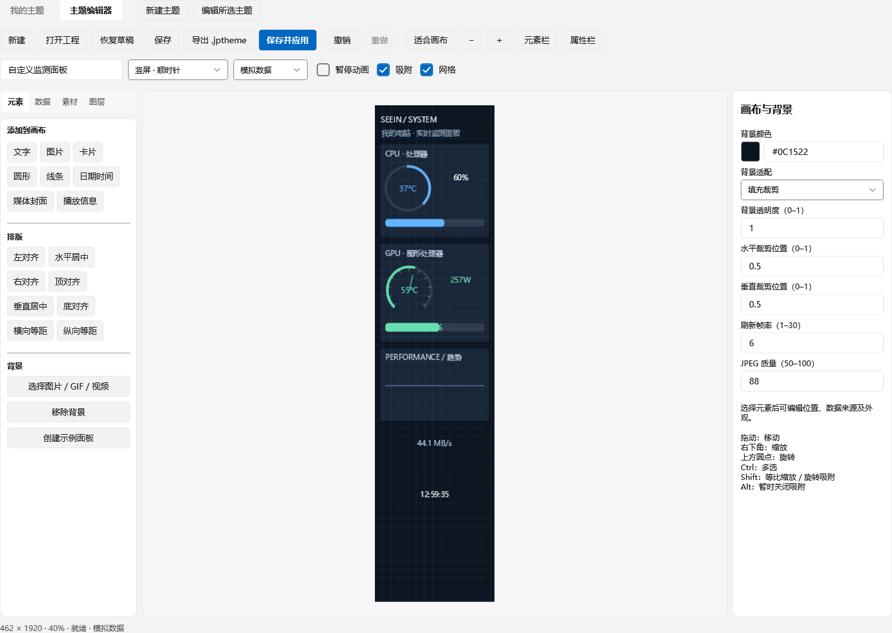
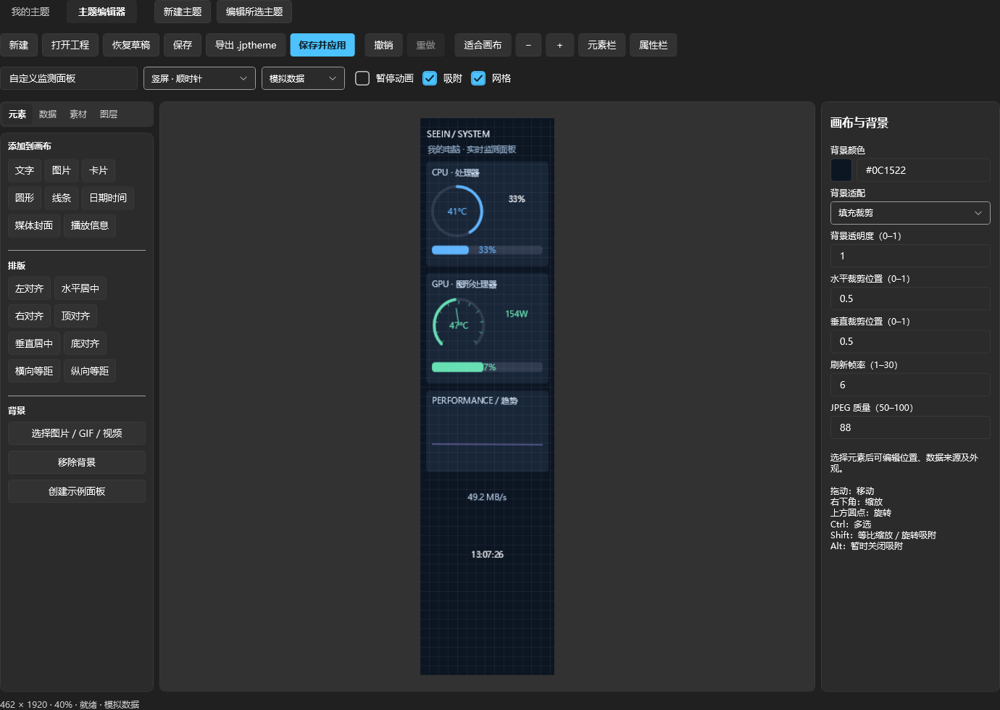

# SEEIN 2.1.0

**Windows 桌面仪表盘、耗能日历，以及六个可按需安装的功能插件。**

SEEIN 把副屏、应用监控、设备控制、桌宠、截图和效率工具组织为可选插件。本体只提供仪表盘、传感器与能耗记录、应用设置、插件和快捷键管理。未安装的功能不会加载其实现或启动辅助程序。

[下载 2.1.0](https://github.com/SJTUHDT/SEEIN/releases/tag/v2.1.0) · [安装](docs/INSTALL.md) · [构建](docs/BUILDING.md) · [隐私与数据](docs/PRIVACY.md) · [第三方来源](THIRD-PARTY-NOTICES.md) · [更新记录](docs/CHANGELOG.md)

## 选择下载

| 下载 | 适合谁 |
|---|---|
| `SEEIN-2.1.0-win-x64-Core.zip` | 只需要仪表盘和耗能记录，或希望自己添加插件 |
| `SEEIN-2.1.0-win-x64-Full.zip` | 希望一次获得六个公开插件；推荐初次使用 |
| `display/applications/devices/companion/capture/efficiency-2.1.0.seeinplugin` | 在应用设置中单独导入需要的插件 |

解压后按安装说明运行安装脚本。后台服务需要管理员权限；查看桌面界面使用普通用户会话。主程序自带 .NET 8；效率工具自带 .NET 10，无需单独安装这两套运行时。网页管理功能需要 Microsoft Edge WebView2 Evergreen Runtime。

Core 下载约 **73 MiB**，解压约 **184 MiB**；Full 下载约 **403 MiB**，解压约 **896 MiB**，不含运行后产生的数据。各插件的额外解压占用约为：应用监控 5.7 MiB、截图录屏 283.5 MiB、桌宠 88.4 MiB、设备控制 53.2 MiB、副屏 103.1 MiB、效率工具 177.9 MiB。完整源码与第三方源码附件供开发及许可使用，不需要下载或放进安装目录。精确值见 Releases 的 COMPONENTS.json。

## 本体

- **仪表盘**：CPU/GPU、内存、网络、磁盘、风扇与温度读数，当前估算功率、会话能耗、累计能耗和使用日历。
- **耗能日历**：按月查看每日能耗和当日功率曲线；分钟曲线保留最近 365 天，日总量长期保留。连续缺采样达到 10 分钟画为零，短缺口继续连接。
- **应用设置**：插件管理和统一快捷键管理。应用列表由应用监控插件提供，未安装时不显示。
- **按需运行**：主窗口关闭到托盘；退出托盘清理桌面功能的子进程，硬件后台独立运行。插件变更通过安全重启生效。
- **界面**：简体中文、明暗主题；展开侧边栏及子页签支持长按一秒悬浮拖动排序。

功耗来自 CPU/GPU 传感器及可配置基线、效率的估算，**不是插座功率计读数**。传感器缺失时不会凭空产生硬件读数。

## 六个插件

| 插件 | 主要功能 | 完整说明 |
|---|---|---|
| 副屏与主题 | 串口 JPEG 显示、主题库、可视化编辑、数据绑定、图片/视频背景、媒体信息、FPS | [副屏与主题](docs/plugins/display.md) |
| 应用监控与应用库 | 日/周时长、时间轴、应用功耗、CPU/GPU 占用、网络流量、应用归并、外观和摘要 | [应用监控](docs/plugins/applications.md) |
| 设备控制 | 显示器 DDC/CI、风扇曲线、灯效/逐灯校色、路由器网页、米家挂灯、采集卡影音播放 | [设备控制](docs/plugins/devices.md) |
| 桌宠与大肥鱼 | 原生桌宠、拖拽停留与抛出、预览菜单、行为设置、对话桥和已有机器人的后台页面 | [桌宠与大肥鱼](docs/plugins/companion.md) |
| 截图录屏与 OCR | 标注、窗口/屏幕/滚动截图、历史、录屏、离线 OCR、翻译、图片转 PDF | [截图录屏](docs/plugins/capture.md) |
| 效率工具与文件搜索 | 启动器、剪贴板、Everything 搜索、文件夹跳转、批量重命名和定时关机 | [效率工具](docs/plugins/efficiency.md) |

插件文档分别列出使用入口、上游项目、SEEIN 的集成修改、依赖、已知边界、联网与存储。集成开源组件的部分保留原作者署名，没有把上游作品改称自研。

## 兼容性与首次设置

- 目标平台为 Windows 10/11 x64；硬件兼容性以 [已验证范围](docs/COMPATIBILITY.md) 为准。
- 副屏当前针对 `VID_33C3 / PID_F101`、1920×462 的设备协议，不能据此保证其他副屏可用。
- 显示器需启用 DDC/CI；灯效、风扇功能只展示驱动和硬件提供的能力。未知硬件不代表已经验证可写。
- 路由器、挂灯地址首次由用户配置；不会默认访问开发者的家庭网络。
- 桌宠自身可使用；大肥鱼对话与后台页面需要另外部署相应服务。连接位置在小工具中的「连接设置」配置。
- 采集播放需要 UVC 视频/USB 音频设备；当前不提供游戏机开关机、录制或推流。

## 界面预览

副屏主题编辑器（使用模拟数据，明暗主题）：





## 开发与反馈

```powershell
pwsh -File scripts/build.ps1 -Configuration Release
pwsh -File scripts/publish.ps1 -Profile Core
# 准备固定依赖后：
pwsh -File scripts/publish.ps1 -Profile PublicFull
```

完整环境准备、工具链和源码对应关系见 [构建说明](docs/BUILDING.md)。[架构](docs/ARCHITECTURE.md)说明插件 API 1、目录及进程归属。

提交问题时请注明 SEEIN/插件版本、Windows 版本、设备型号和复现步骤。请勿上传登录令牌、密码、完整剪贴板或个人数据库。安全问题请按 [安全反馈](SECURITY.md)处理。

SEEIN 自有代码采用 [GPL-3.0-only](LICENSE)。第三方代码、字体、图像和动画按各自许可证分发，见 [第三方声明](THIRD-PARTY-NOTICES.md)。

## English

SEEIN is a Chinese-language Windows x64 dashboard and energy calendar with six optional modules: panel/themes, application monitoring, device control, native pets/Dafeiyu integration, capture/OCR, and productivity/file search. Modified Snow Shot and Pane components retain their upstream licenses and corresponding source. Download Core or Full from Releases; see the linked module guides for requirements and limitations.
